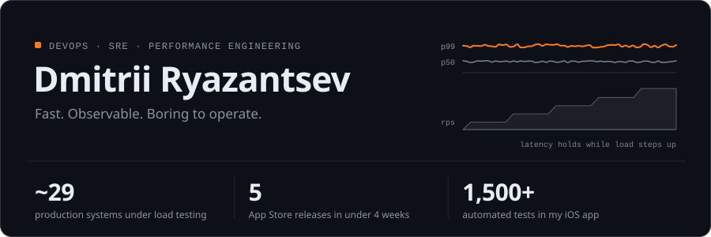
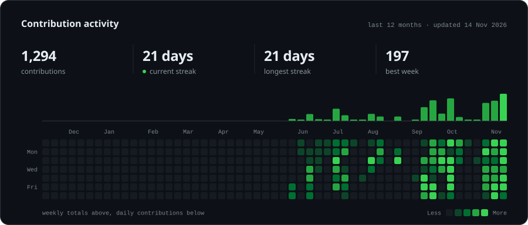
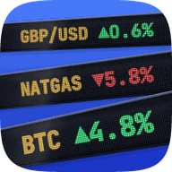

<picture>
  <source media="(prefers-color-scheme: dark)" srcset="https://raw.githubusercontent.com/1ntr0men/1ntr0men/output/hero-dark.svg" />
  <source media="(prefers-color-scheme: light)" srcset="https://raw.githubusercontent.com/1ntr0men/1ntr0men/output/hero-light.svg" />
  
</picture>

I make production systems **fast, observable and predictable under load** - and ship my own apps to the App Store on the side.

<picture>
  <source media="(prefers-color-scheme: dark)" srcset="https://raw.githubusercontent.com/1ntr0men/1ntr0men/output/activity-dark.svg" />
  <source media="(prefers-color-scheme: light)" srcset="https://raw.githubusercontent.com/1ntr0men/1ntr0men/output/activity-light.svg" />
  
</picture>

### What I do

- **Performance engineering at scale** - lead a load testing practice covering ~29 production systems in fintech: test design, capacity planning, bottleneck analysis, RCA.
- **Load testing as self-service** - piloting on-demand load tests on k6 + Jenkins + Grafana, so product teams run them without a dedicated engineer.
- **Observability** - Prometheus, Grafana, OpenTelemetry, Loki, Tempo, Mimir, VictoriaMetrics, Vector, ELK, Sentry.
- **Platform** - Kubernetes, Docker, Linux.

### Toolbox

<picture>
  <source media="(prefers-color-scheme: dark)" srcset="https://skillicons.dev/icons?i=kubernetes%2Cdocker%2Clinux%2Cprometheus%2Cgrafana%2Cjenkins%2Cgit%2Cswift%2Cjava%2Cpy%2Cjs%2Cbash&theme=dark&perline=12" />
  <source media="(prefers-color-scheme: light)" srcset="https://skillicons.dev/icons?i=kubernetes%2Cdocker%2Clinux%2Cprometheus%2Cgrafana%2Cjenkins%2Cgit%2Cswift%2Cjava%2Cpy%2Cjs%2Cbash&theme=light&perline=12" />
  
</picture>

### Apps I ship

<table>
  <tr>
    <td width="132" align="center">
      
    </td>
    <td>
      <b><a href="https://apps.apple.com/us/app/ember-smoke-less/id6810363404">Ember: Smoke Less</a></b> &nbsp;·&nbsp; iOS &nbsp;·&nbsp; live on the App Store 
      Cigarette tracker for cutting down gradually: one-tap logging, trends, widgets and Siri. 
      SwiftUI · SwiftData · Swift Charts · WidgetKit · App Intents · RealityKit  
      <a href="https://apps.apple.com/us/app/ember-smoke-less/id6810363404"><picture>
        <source media="(prefers-color-scheme: dark)" srcset="https://raw.githubusercontent.com/1ntr0men/1ntr0men/output/appstore-dark.svg" />
        <source media="(prefers-color-scheme: light)" srcset="https://raw.githubusercontent.com/1ntr0men/1ntr0men/output/appstore-light.svg" />
        
      </picture></a>
    </td>
  </tr>
  <tr>
    <td width="132" align="center">
      
    </td>
    <td>
      <b>Tape</b> &nbsp;·&nbsp; macOS &nbsp;·&nbsp; in development 
      Portfolio analytics across Russian brokers (T-Bank, BCS, Finam, ALOR, Alfa): real return vs. deposits and inflation, dividends and coupons, taxes, risk. Read-only, data stays on the Mac. Menu bar ticker and widgets included. 
      SwiftUI · Swift Charts · WidgetKit · App Intents · Sparkle
    </td>
  </tr>
</table>

Built with an AI-native workflow: Claude Code agents write the code, I own architecture, review and releases. App source code is private.
